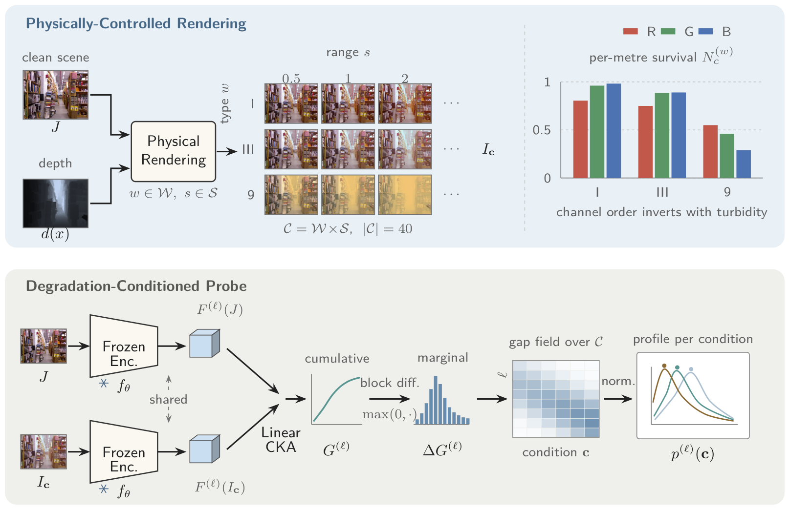
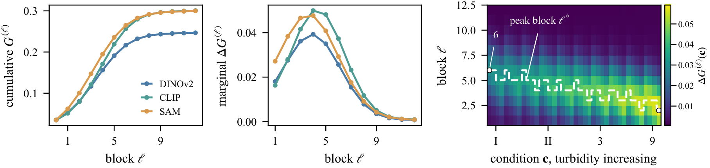
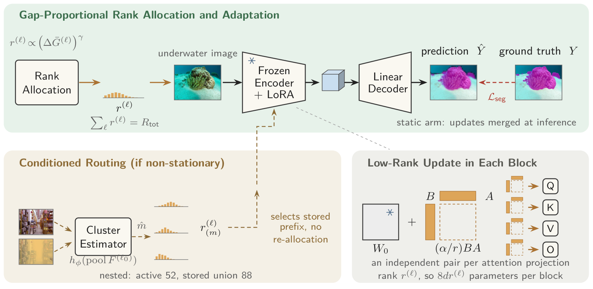

<div align="center">

<h1>AquaProbe: Efficient Adaptation of Frozen Vision Models for Underwater Images</h1>

**Md Shihabul Islam Shovo**<sup>1</sup> &nbsp;·&nbsp; **Nishi Kanta Paul**<sup>1</sup> &nbsp;·&nbsp; **Trung Dong**<sup>2</sup> &nbsp;·&nbsp; **Xiaomin Lin**<sup>2</sup>

<sup>1</sup>NIMISHES Lab, Dhaka, Bangladesh &nbsp;&nbsp; <sup>2</sup>University of South Florida

*MaCVi 2027 · 5th Workshop on Maritime Computer Vision at WACV 2027*

[](https://arxiv.org/abs/2610.40900)


[**Paper**](https://arxiv.org/abs/2610.40900) &nbsp;|&nbsp; [**PDF**](https://arxiv.org/pdf/2610.40900) &nbsp;|&nbsp; [**BibTeX**](#citation)

</div>

<p align="center">
  
</p>

<p align="center"><em>
Clean RGB-D scenes are rendered across Jerlov water types and imaging ranges. Clean and rendered pairs pass
through the same frozen encoder, which gives the per-block divergence field over the condition grid and the
normalised profile for each condition.
</em></p>

## Overview

Vision backbones pretrained on terrestrial images become less reliable underwater, where wavelength-dependent
attenuation, backscatter and turbidity change scene appearance. Parameter-efficient fine-tuning freezes the backbone
and trains a small set of extra weights, but it leaves open where in the encoder a limited adaptation budget should
go. Existing methods either spread adapters evenly across depth or choose layers from the divergence between two
fixed datasets.

AquaProbe measures where the underwater domain gap grows inside a frozen vision transformer and how that location
changes with water type and imaging range. It renders clean RGB-D scenes with a physical two-term formation model,
which changes the degradation while holding scene content fixed. It then records the **per-block increase** in
representation divergence between clean and rendered images, rather than the cumulative layer-wise divergence. The
condition-averaged profile sets each block's LoRA rank under a fixed budget, and an exploratory router selects among
nested per-cluster allocations when the profile depends on the imaging condition.

## Highlights

<p align="center">
  
</p>

- **Cumulative divergence points at the output; the per-block increase does not.** For DINOv2, CLIP and SAM the
  cumulative gap saturates near the final blocks, while the condition-averaged per-block increase is unimodal and
  peaks between the third and fifth blocks.
- **The gap moves with the water.** The peak shifts from block six in clear, short-range water to block two in the
  most turbid, long-range condition. The drift index is **5.2×** the resampling null for DINOv2, and the peak block
  correlates with turbidity at **ρ = −0.86 to −0.88** across the three backbones.
- **The per-block increase tracks adaptation utility.** Adapting one block at a time, utility follows the measured
  increment with **ρ = 0.82** (bootstrap interval [0.47, 0.95]); the cumulative gap gives **−0.71**.
- **Same budget, better allocation.** On SUIM with DINOv2, profile-proportional allocation reaches **70.1 mIoU**,
  **+1.9** over uniform LoRA at the same **0.59M** adapter parameters (0.68% of the backbone). Uniform allocation needs
  four times the adapter parameters to match it.
- **The direction of the profile matters.** Random allocation matches uniform within noise, while allocating by the
  reversed profile is worse than both.
- **It transfers.** Allocation from each backbone's own profile adds **+1.5 mIoU** on SAM ViT-B and **+1.5 mIoU** on
  TrashCan, deep-sea footage under artificial lighting that the formation model does not describe.

| ID | Method | Allocation signal | Trainable params (M) | mIoU (%) | Boundary F (%) | AUDRC (%) |
|:---|:---|:---|:---:|:---:|:---:|:---:|
| B0 | Frozen encoder with decoder | none | 0.00 | 61.4 ± 0.3 | 44.1 | 52.1 |
| B2 | Uniform LoRA | none | 0.59 | 68.2 ± 0.5 | 51.3 | 59.8 |
| B5a | Random allocation | none | 0.59 | 68.0 ± 0.9 | 51.0 | 59.4 |
| B5b | Reversed profile | reversed $\Delta\bar{G}^{(\ell)}$ | 0.59 | 66.9 ± 0.6 | 49.8 | 58.1 |
| B6a | AdaLoRA | training importance | 0.59 | 68.9 ± 0.5 | 52.1 | 60.3 |
| B6b | RepSAM bands | cross-domain $G^{(\ell)}$ | 0.59 | 69.3 ± 0.5 | 52.8 | 60.9 |
| B7 | **AquaProbe, static** | $\Delta\bar{G}^{(\ell)}$ | 0.59 | **70.1 ± 0.4** | **53.6** | **61.9** |
| B8 | AquaProbe, routed (exploratory) | per-cluster | 0.59 | 70.6 ± 0.5 | 54.2 | 63.4 |
| B1 | Full fine-tuning | none | 86.6 | 71.8 ± 0.7 | 55.4 | 63.9 |

<sub>SUIM test set, DINOv2 ViT-B/14, $R_{\text{tot}}=96$. mIoU is the mean ± standard deviation over three seeds
(five for random allocation). Trainable parameters exclude the shared 6.2K decoder; the routed count includes the
router. Full fine-tuning is an unequal-budget reference. AUDRC holds out imaging ranges within the same renderer and
Jerlov water types. Routing gains overlap with the static arm's seed variability, so static AquaProbe is the default.</sub>

## Method

AquaProbe has a measurement stage and an adaptation stage.

**Physically controlled rendering.** For clean radiance $J$ and camera-to-scene range $z(x)$, the rendered image is

$$I_c(x) = J_c(x)\,t_c(x) + B_c^{\infty}\bigl(1-t_c(x)\bigr), \qquad t_c(x) = \bigl(N_c^{(w)}\bigr)^{z(x)},$$

where $N_c^{(w)}$ is the per-metre survival fraction of channel $c$ for Jerlov water type $w$ and
$z(x)=s\,[z_{\min}+(z_{\max}-z_{\min})\,\hat{d}(x)]$ for a range multiplier $s$. The grid covers ten Jerlov types
(I, IA, IB, II, III, 1C, 3C, 5C, 7C, 9C) and $s\in\{0.5,1,2,4\}$, giving 40 conditions.

**Per-block increase in divergence.** With $F^{(\ell)}$ the mean-pooled patch tokens after block $\ell$, the
cumulative gap and its per-block increase are

$$G^{(\ell)}(\mathbf{c}) = 1-\mathrm{CKA}\bigl(F^{(\ell)}(J),\,F^{(\ell)}(I_{\mathbf{c}})\bigr), \qquad
\Delta G^{(\ell)}(\mathbf{c}) = \max\bigl(0,\;G^{(\ell)}(\mathbf{c})-G^{(\ell-1)}(\mathbf{c})\bigr).$$

CKA is computed in a different feature space at each depth, so $\Delta G^{(\ell)}$ does not establish whether an
increase originates within block $\ell$ or propagates from earlier blocks. It is used as an empirical allocation
indicator, and its relevance is tested separately by the single-block utility sweep.

**Stationarity.** The profile drift index (PDI) is the mean pairwise Jensen–Shannon divergence between normalised
profiles over the grid. A profile is non-stationary when the PDI exceeds the upper 5% of a resampling null and the
peak block $\ell^{*}$ varies by more than one block.

**Gap-proportional rank allocation.** Given a budget $R_{\text{tot}}$ and a sharpening exponent $\gamma$,

$$\tilde{r}^{(\ell)} = R_{\text{tot}}\,\frac{\bigl(\Delta\bar{G}^{(\ell)}\bigr)^{\gamma}}{\sum_{j}\bigl(\Delta\bar{G}^{(j)}\bigr)^{\gamma}},
\qquad P_{\text{adapter}} = \sum_{\ell} 8\,d\,r^{(\ell)} = 8\,d\,R_{\text{tot}},$$

and a water-filling projection (Algorithm 1) clips to $[r_{\min},r_{\max}]$ before integerising, so every allocation
meets the budget exactly. $\gamma=0$ reproduces uniform allocation. LoRA adapts the query, key, value and output
projections of every block, and the static update merges into the frozen weights at inference.

<p align="center">
  
</p>

**Conditioned routing (exploratory).** When the profile is non-stationary, the condition grid is clustered by
average linkage on Jensen–Shannon distances, and each cluster receives its own allocation. The allocations share
nested LoRA factors, and a router on adapter-free features after block 2 selects the prefix. The router's 49,344
parameters are charged against the budget, so the stored union is 88 ranks instead of 96. Routing cannot be merged
into the weights, and its gain is not conclusive, so static AquaProbe is the recommended default.

## Repository structure

```
.
├── main.py                 adaptation stage: trains and evaluates one arm for one seed
├── probe.py                measurement stage: divergence field, stationarity, attribution, UIEB probe, FID, cross-domain gap
├── models/
│   ├── aquaprobe.py        segmenter, router and timm model registration
│   ├── backbones.py        frozen DINOv2 / CLIP / SAM ViT-B backbones, block features and token maps
│   ├── adapters.py         nested-prefix LoRA on q, k, v, o, SVD adapters, merging and parameter counts
│   └── adalora.py          AdaLoRA importance scores, cubic budget schedule and orthogonality penalty
├── util/
│   ├── render.py           Jerlov table and the two-term formation model
│   ├── divergence.py       linear CKA, mutual k-NN, per-block increase, profiles, PDI, null and stationarity
│   ├── allocation.py       water-filling allocation, baseline allocations, clustering and nested allocations
│   ├── datasets.py         NYU Depth V2, SUIM, TrashCan and UIEB loaders and the held-out training slice
│   ├── depth.py            MiDaS inverted inverse depth for SUIM and TrashCan
│   ├── engine.py           training loop, sliding-window evaluation, AUDRC, router accuracy and merge check
│   ├── losses.py           cross-entropy, Dice and routing losses
│   ├── metrics.py          mIoU, boundary F-score and AUDRC
│   ├── fid.py              Fréchet Inception Distance
│   ├── options.py          data, rendering and runtime arguments
│   └── utils.py            logging, seeding, learning-rate schedule and I/O
├── tools/
│   ├── prepare_data.py     extracts the NYU Depth V2 and SUIM archives
│   ├── cache_depth.py      computes monocular depth once per image
│   ├── run_experiments.py  runs every stage of the paper in order
│   ├── aggregate.py        collects runs into results tables and analysis.json
│   └── report.py           regenerates the paper's tables and figures
├── assets/
└── requirements.txt
```

## Installation

The code was developed with Python 3.11 and PyTorch 2.8. From the repository root:

```bash
python3.11 -m venv .venv
source .venv/bin/activate
pip install torch==2.8.0 torchvision==0.23.0
pip install -r requirements.txt
```

Pretrained weights are downloaded on first use and cached by timm and `torch.hub`.

| Component | Model |
|:---|:---|
| Backbones | [DINOv2 ViT-B/14](https://huggingface.co/timm/vit_base_patch14_dinov2.lvd142m), [CLIP ViT-B/16](https://huggingface.co/timm/vit_base_patch16_clip_224.openai), [SAM ViT-B](https://huggingface.co/timm/samvit_base_patch16.sa1b) |
| Monocular depth for SUIM and TrashCan | [MiDaS DPT-Large](https://github.com/isl-org/MiDaS) through `torch.hub` |
| Rendering fidelity | Inception-v3 from [pytorch-fid](https://github.com/mseitzer/pytorch-fid) |

## Data

| Dataset | Role | Source |
|:---|:---|:---|
| NYU Depth V2, labelled subset (1449 RGB-D pairs) | probe pool for rendering | [NYU Depth V2](https://cs.nyu.edu/~fergus/datasets/nyu_depth_v2.html) |
| SUIM (1525 train/val, 110 test, 8 classes) | main segmentation benchmark | [SUIM](https://github.com/xahidbuffon/SUIM) |
| TrashCan 1.0, material version | transfer benchmark | [TrashCan 1.0](https://doi.org/10.13020/g1gx-y834) |
| UIEB (890 raw and reference images) | real-image probe and FID | [UIEB](https://li-chongyi.github.io/proj_benchmark.html) |

The default paths are:

```
data/
├── nyu_depth_v2_labeled.mat
├── SUIM/
│   ├── train_val/{images,masks}
│   └── TEST/{images,masks}
├── TrashCan/material_version/
└── UIEB/{raw-890,reference-890}
```

The NYU DenseDepth export (`nyu_data.zip`) is also supported with `--nyu-format densedepth`. Archives can be
extracted with

```bash
python tools/prepare_data.py --nyu-zip /path/to/nyu_data.zip --nyu-format densedepth --nyu-path data/NYU \
    --suim-zip /path/to/SUIM.zip --suim-path data/SUIM
```

SUIM and TrashCan have no measured depth, so monocular depth is cached once:

```bash
python tools/cache_depth.py --data-set suim
python tools/cache_depth.py --data-set trashcan
```

## Reproducing the paper

Run every stage in order:

```bash
python tools/run_experiments.py --output_dir output --keep-going
```

The runner skips runs whose outputs already exist, so it resumes after an interruption. Stages can also be run on
their own:

```bash
python tools/run_experiments.py --output_dir output --stages probe sensitivity attribution realprobe fid crossdomain
python tools/run_experiments.py --output_dir output --stages utility gamma
python tools/run_experiments.py --output_dir output --stages main ablations transfer
python tools/aggregate.py --output_dir output
python tools/report.py --output_dir output
```

| Stage | Description | Paper |
|:---|:---|:---|
| `depth` | MiDaS depth for SUIM and TrashCan | Sec. 4.1 |
| `probe` | Divergence field, stationarity and mutual k-NN agreement for DINOv2, CLIP and SAM | Sec. 3.3–3.4, Tab. 1, Fig. 3 |
| `sensitivity` | Class token, halved condition grid, 0.5–8 m range interval and a 256-image pool | Sec. 5.4 |
| `attribution` | Channel attribution $A_c$ for water types I and 9C | Sec. 5.2 |
| `realprobe` | Profile of the UIEB raw–reference pairs and UCIQE groups | Sec. 5.2 |
| `fid` | FID of each rendered water type to SUIM and UIEB | Sec. 5.1 |
| `crossdomain` | Cumulative NYU–SUIM gap for the RepSAM bands | Sec. 4.3 |
| `utility` | Single-block sweep with $r_{\text{probe}}=4$ and two seeds per block | Sec. 3.5, 5.3, Fig. 4 |
| `gamma` | Selection of $\gamma$ on a held-out slice of the SUIM training split | Sec. 4.4 |
| `main` | Equal-budget comparison B0–B8 | Tab. 2 |
| `ablations` | $\gamma$, allocation signal, similarity statistic, $r_{\min}$ and uniform budget | Tab. 3 |
| `transfer` | SAM ViT-B on SUIM and DINOv2 on TrashCan | Tab. 3, Sec. 5.5 |
| `aggregate` | Results tables, utility validity, efficiency and allocation checks | |
| `report` | Paper tables and figures | |

The measurement stage can also be run directly:

```bash
python probe.py --task profile --backbone dinov2_vitb14 --output_dir output/probe
python probe.py --task attribution --backbone dinov2_vitb14 --output_dir output/probe
python probe.py --task realprobe --backbone dinov2_vitb14 --output_dir output/probe
python probe.py --task fid --output_dir output/probe
python probe.py --task crossdomain --backbone dinov2_vitb14 --output_dir output/probe
```

One arm of the adaptation stage is trained and evaluated with

```bash
python main.py --model aquaprobe_dinov2_vitb14 --arm aquaprobe --data-set suim --seed 0 \
    --probe-path output/probe --output_dir output/runs/dinov2_vitb14/suim/aquaprobe/seed0
```

and a trained checkpoint is evaluated with

```bash
python main.py --model aquaprobe_dinov2_vitb14 --arm aquaprobe --data-set suim --probe-path output/probe \
    --resume output/runs/dinov2_vitb14/suim/aquaprobe/seed0/checkpoint.pth --eval --output_dir output/eval
```

| Paper | Arm | `--arm` |
|:---|:---|:---|
| B0 | Frozen encoder with decoder | `frozen` |
| B1 | Full fine-tuning | `full` |
| B2 | Uniform LoRA | `uniform` |
| B5a | Random allocation | `random` |
| B5b | Reversed profile | `reversed` |
| B6a | AdaLoRA | `adalora` |
| B6b | RepSAM bands | `repsam` |
| B7 | AquaProbe, static | `aquaprobe` |
| B8 | AquaProbe, routed | `routed` |
| Sec. 3.5 | Single-block utility | `single_block` |

### Default configuration

The defaults in `main.py`, `probe.py` and `util/options.py` follow the paper.

| Setting | Flag | Default |
|:---|:---|:---|
| Total rank budget $R_{\text{tot}}$ | `--r-tot` | 96 |
| Sharpening exponent $\gamma$ | `--gamma` | 1.0 |
| Rank bounds for non-uniform allocations | `--r-min`, `--r-max` | 0, 24 |
| LoRA scaling $\alpha$ | `--lora-alpha` | 16 |
| Router clusters, input block, hidden width | `--router-clusters`, `--router-layer`, `--router-hidden` | 3, 2, 64 |
| Learning rates for adapters and decoder | `--lr-adapter`, `--lr-decoder` | 3e-4, 1e-3 |
| Weight decay, warm-up epochs | `--weight-decay`, `--warmup-epochs` | 0.01, 1 |
| Batch size, epochs | `--batch-size`, `--epochs` | 16, 40 |
| Dice weight $\lambda_{\text{dice}}$ | `--lambda-dice` | 1.0 |
| Range multipliers $\mathcal{S}$ | `--ranges` | 0.5 1 2 4 |
| Held-out range multipliers $\mathcal{S}'$ | `--heldout-ranges` | 0.25 0.75 1.5 3 5 |
| Bootstrap resamples, null profiles | `--n-bootstrap`, `--n-null` | 20, 200 |
| Mutual k-NN neighbours | `--knn-k` | 10 |
| Single-block probe rank $r_{\text{probe}}$ | `--probe-rank` | 4 |
| Seed | `--seed` | 0 |

The paper does not state the following values; the defaults below are the choices made in this code.

| Setting | Flag | Default |
|:---|:---|:---|
| Range interval $[z_{\min}, z_{\max}]$ | `--z-min`, `--z-max` | 1.0, 4.0 m |
| Veiling light $B_c^{\infty}$ | `--veiling-mode`, `--veiling-level`, `--veiling-exponent` | $0.8\,(N_c/\max_c N_c)^{1.15}$ |
| Render-augmentation probability | `--render-prob` | 0.5 |
| Routing loss weight $\lambda_{\text{route}}$ | `--lambda-route` | 1.0 |
| Router and full fine-tuning learning rates | `--lr-router`, `--lr-full` | 1e-3, 3e-5 |
| LoRA $A$ initialisation | `--lora-init-std` | $\mathcal{N}(0, 0.02^2)$ |
| AdaLoRA initial rank, schedule, $\beta_1=\beta_2$, orthogonality weight | `--adalora-*` | 12, 10% / 20%, 0.85, 0.1 |
| Sliding-window stride, boundary tolerance | `--stride-ratio`, `--boundary-tol` | 2/3 of the crop, 0.8% of the diagonal |
| Held-out slice for $\gamma$ selection | `--heldout-fraction` | 10% of SUIM train/val |

Run `python main.py --help` or `python probe.py --help` for the full list.

## Scope

The probe renders indoor NYU Depth V2 scenes with a simplified two-term model that does not reproduce all optical
characteristics of real water, such as forward scattering, spatially varying illumination and separate direct and
backscatter coefficients. Its profiles are physically motivated allocation signals, not exact representations of
every underwater condition. The evaluation covers semantic segmentation only; the probe uses no task labels, but its
effectiveness for object detection or depth estimation has not been established.

## Citation

If you find this work useful, please cite:

```bibtex
@inproceedings{shovo2027aquaprobe,
  title         = {AquaProbe: Efficient Adaptation of Frozen Vision Models for Underwater Images},
  author        = {Shovo, Md Shihabul Islam and Paul, Nishi Kanta and Dong, Trung and Lin, Xiaomin},
  booktitle     = {Proceedings of the IEEE/CVF Winter Conference on Applications of Computer Vision (WACV) Workshops},
  year          = {2027},
  eprint        = {2610.40900},
  archivePrefix = {arXiv}
}
```

## Acknowledgements

We thank the authors of [NYU Depth V2](https://cs.nyu.edu/~fergus/datasets/nyu_depth_v2.html),
[SUIM](https://github.com/xahidbuffon/SUIM), [TrashCan](https://doi.org/10.13020/g1gx-y834)
and [UIEB](https://li-chongyi.github.io/proj_benchmark.html) for making their data available, and the developers of
[timm](https://github.com/huggingface/pytorch-image-models), [DINOv2](https://github.com/facebookresearch/dinov2),
[CLIP](https://github.com/openai/CLIP), [Segment Anything](https://github.com/facebookresearch/segment-anything),
[MiDaS](https://github.com/isl-org/MiDaS) and [pytorch-fid](https://github.com/mseitzer/pytorch-fid).
The datasets and pretrained models remain subject to their own licenses.

## Contact

For questions, please open an issue or contact Md Shihabul Islam Shovo (shihabul900@gmail.com) or
Nishi Kanta Paul (nishikantapaul108@gmail.com).
